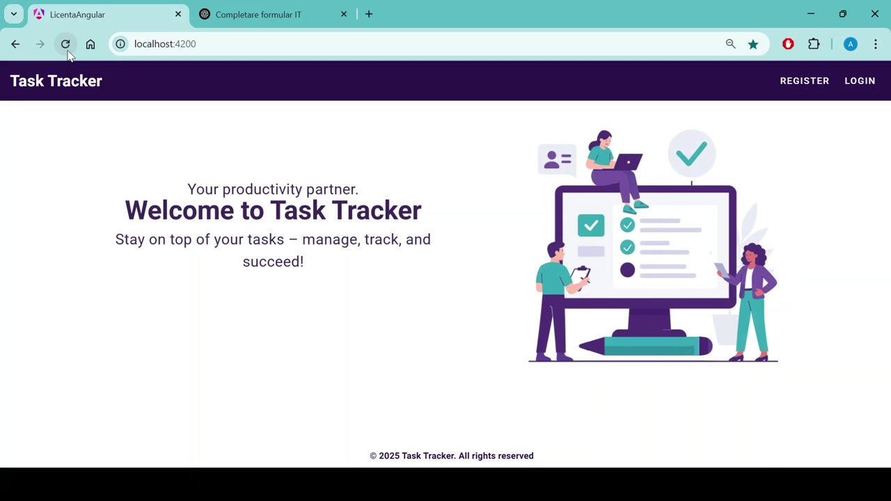
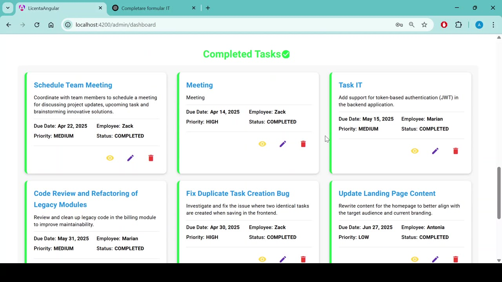
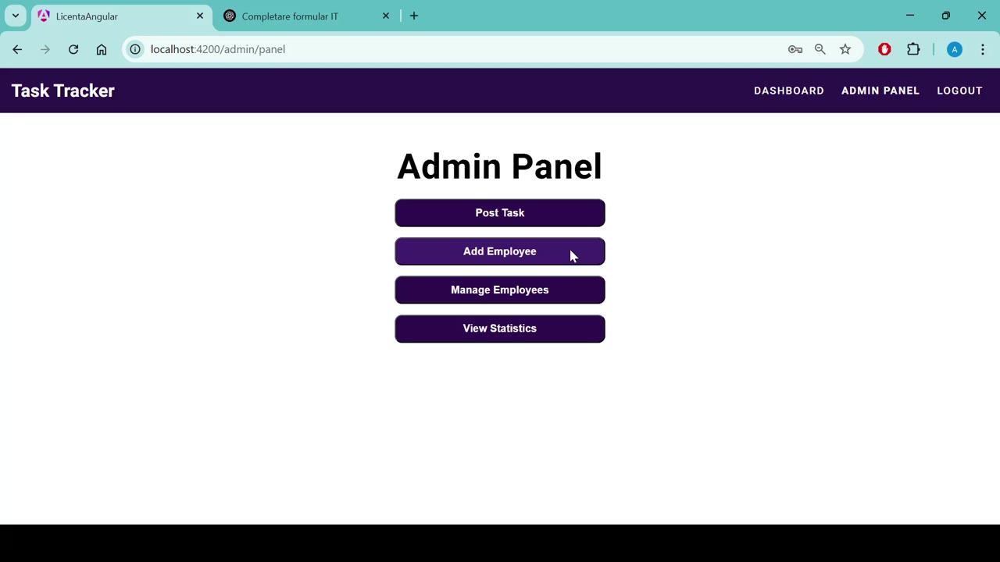
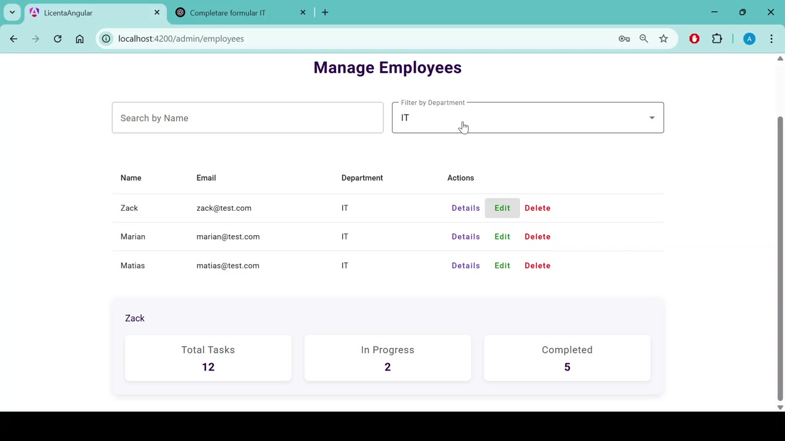
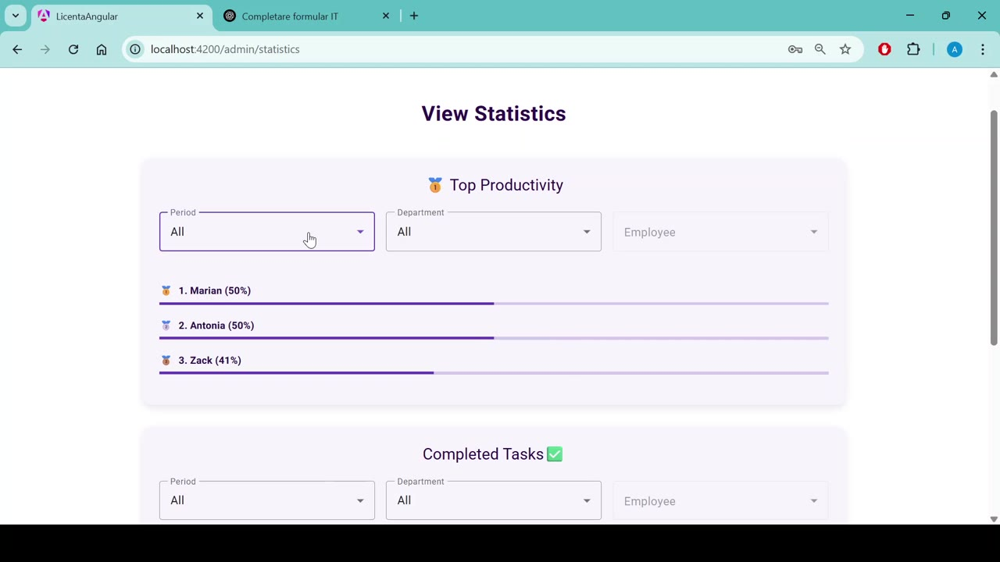
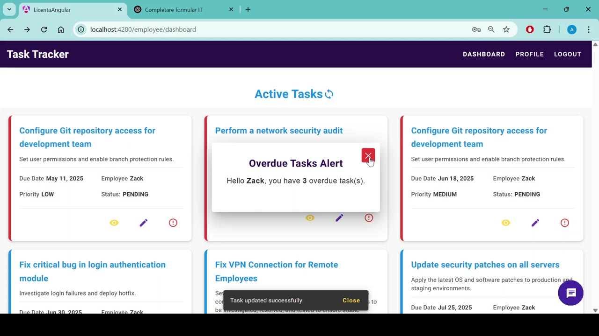
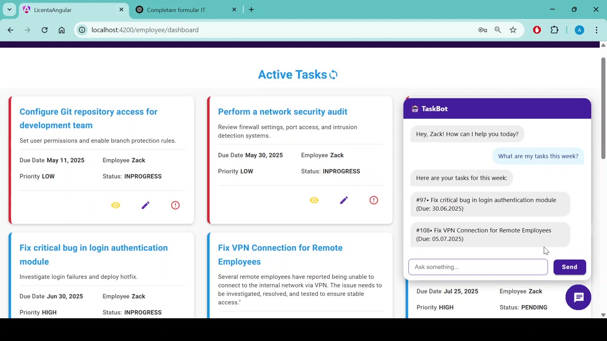

# Task Tracker – Employee & Task Management Web App

A full-stack web application for managing employees and the tasks assigned to them within an organization. Administrators organize employees by department, assign and track tasks, and monitor productivity through statistics. Employees see their own tasks, update their progress, and get alerts for overdue work.

> 🎓 Bachelor's thesis project – Transilvania University of Brașov, Department of Automation and Information Technology (2025)
> Scientific coordinator: Assoc. Prof. Dr. Eng. Dominic M. Kristaly



---

## ✨ Features

### Authentication & roles
- User registration and login secured with **JWT (JSON Web Tokens)** and **Spring Security**
- **Role-based access**: separate interfaces and permissions for **Admin** and **Employee**

### Admin
- **Dashboard** with tasks grouped by status (Pending, In Progress, Completed, Overdue) and color-coded cards
- **Create, edit, view and delete tasks**: title, description, due date, priority (Low / Medium / High), department and assigned employee
- **Manage employees**: add, edit and delete (with confirmation), search by name, filter by department (IT, HR, Marketing, Finance)
- **Per-employee summary**: total, in-progress and completed tasks
- **Statistics page**:
  - *Top Productivity* ranking, filterable by period (last week, current month, current year), department and employee
  - *Completed Tasks* overview with the same filters
  - Advanced statistics

### Employee
- **Personal dashboard** with active tasks and status updates
- **Overdue tasks alert** shown on login
- **Comments** on tasks
- **Profile page** with personal task statistics
- **TaskBot**, an in-app chat assistant that answers simple requests such as:
  - *"What are my tasks this week?"*
  - *"Show tasks in progress"*
  - *"Mark task 96 as complete"*

---

## 🛠 Tech Stack

| Layer | Technologies |
|---|---|
| Frontend | Angular (SPA), TypeScript, HTML, CSS |
| Backend | Java, Spring Boot, Spring Security, JWT, Spring Data JPA / Hibernate |
| Database | MySQL |
| Tools | Postman (API testing), Git |

---

## 🏗 Architecture

The application follows a layered **MVC + REST** architecture:

- **Model** – Java entities (`User`, `Task`, `Comment`) mapped to the database via JPA
- **View** – Angular interface, displaying data tailored to each user role
- **Controller** – Spring REST controllers that receive requests, apply business logic and return JSON

The Angular client communicates with the Spring Boot backend through a REST API, sending the JWT on each authenticated request.

### Database

| Table | Main attributes |
|---|---|
| `users` | id, email, name, password, user_role, department |
| `task` | id, title, description, due_date, priority, task_status, user_id |
| `comment` | id, task_id, user_id, content, created_at |

Relationships:
- A **User** can have multiple **Tasks** (1:N)
- A **User** can post multiple **Comments** (1:N)
- A **Task** can have multiple **Comments** (1:N)

---

## 📸 Screenshots

| Admin dashboard | Admin panel |
|---|---|
|  |  |

| Manage employees | Statistics |
|---|---|
|  |  |

| Employee – overdue alert | Employee – TaskBot |
|---|---|
|  |  |

🎥 **Demo video:** [link to demo video]

---

## 🚀 Getting Started

### Prerequisites
- Java [17] or newer
- Node.js and Angular CLI
- MySQL Server
- Maven

### 1. Database
```sql
CREATE DATABASE [database_name];
```

### 2. Backend (Spring Boot)
Configure `src/main/resources/application.properties`:
```properties
spring.datasource.url=jdbc:mysql://localhost:3306/[database_name]
spring.datasource.username=[your_username]
spring.datasource.password=[your_password]
spring.jpa.hibernate.ddl-auto=update
```

Run the backend:
```bash
cd [backend-folder]
mvn spring-boot:run
```
The API runs on `http://localhost:8080`.

### 3. Frontend (Angular)
```bash
cd [frontend-folder]
npm install
ng serve
```
Open `http://localhost:4200` in your browser.

---

## 🔮 Future Improvements
- Automatic notifications for overdue tasks
- Better mobile optimization
- Data export for reports and archiving
- Google Calendar integration for deadlines
- Attachments on tasks and comments
- Change history to track user actions

---

## 👩‍💻 Author

**Andreea Condrache**
[LinkedIn](https://www.linkedin.com/in/andreea-condrache-0a1762268/)
